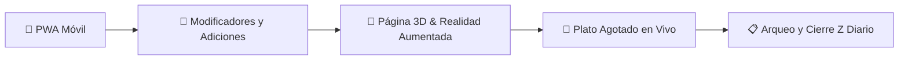
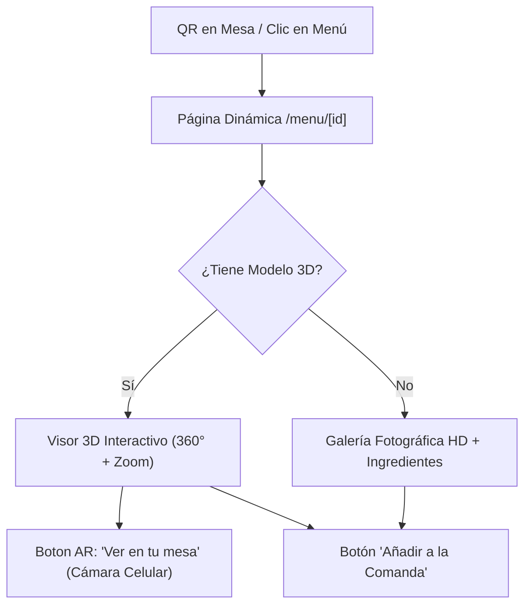

# 🚀 Plan de Evolución Tecnológica — SazonareFood

Este documento reúne las especificaciones funcionales y arquitectónicas de las próximas 5 funcionalidades clave para llevar **SazonareFood** a un estándar comercial de primer nivel.

---

---

## 1. 📋 Arqueo y Cierre de Caja Diario (Reporte Z Imprimible) — ✅ COMPLETADO

### Objetivo
Permitir al administrador o cajero realizar el cuadre formal de caja al terminar cada turno o jornada, controlando el dinero en efectivo físico contra las ventas registradas por el sistema.

### Funcionalidades Clave
1. **Fondo Inicial (Base de Caja):**
   * Registro del efectivo con el que abre la caja en la mañana (ej: $100.000 COP para cambios).
2. **Arqueo Ciego / Conteo Físico Interactivo:**
   * El cajero ingresa el dinero físico contado o usa la calculadora integrada de billetes y monedas (COP).
   * El sistema calcula automáticamente:
     $$\text{Efectivo Esperado} = \text{Base Inicial} + \text{Ventas en Efectivo} - \text{Retiros/Gastos}$$
     $$\text{Diferencia} = \text{Efectivo Físico} - \text{Efectivo Esperado} \quad (\text{Cuadre exacto, Sobrante o Faltante})$$
3. **Ticket Térmico de Cierre (Reporte Z):**
   * Formato imprimible para impresora térmica de 80mm / 58mm con `@media print`:
     * Fecha y hora oficial de Colombia (`America/Bogota`).
     * Desglose: Ventas en Efectivo, Transferencias (Nequi/Daviplata/Bancolombia), Ventas Netas.
     * Número de pedidos atendidos y ticket promedio.
     * Cuadro de auditoría de arqueo (Base, Efectivo esperado, Efectivo real, Diferencia).
     * Espacio para observaciones y firma física del cajero/administrador.
4. **Historial de Cierres Auditados:**
   * Tabla histórica en Supabase con estados de cuadre y botón para re-imprimir cualquier Reporte Z en cualquier momento.

---

## 2. 🥓 Adiciones y Descripción en Comandas (Indicaciones para Cocina) — ✅ COMPLETADO

### Objetivo
Permitir que los meseros envíen de manera ultrarrápida (en 1 toque) especificaciones y personalizaciones para la cocina (ej: "Sin lechuga", "Sin salsas", "Salsas aparte", "Término 3/4") sin entorpecer la toma de pedidos con modales individuales innecesarios.

### Funcionalidades Implementadas
1. **Adición Directa con 1 Toque:**
   - Se eliminaron modales intermedios para alimentos y bebidas. Al tocar un ítem se agrega o suma inmediatamente a la orden.
2. **Chips Rápidos de Indicaciones en Carrito:**
   - Botones táctiles preconfigurados de un toque: `Sin salsas`, `Sin cebolla`, `Sin tomate`, `Sin lechuga`, `Salsas aparte`, `Término 3/4`, `Bien cocido`, `Sin hielo`.
3. **Campo Libre de Descripción:**
   - Área de texto para observaciones específicas adicionales sin pérdida de foco en teclados virtuales móviles.
4. **Visualización Integral:**
   - Las notas e indicaciones se transmiten en tiempo real a los monitores de cocina (`/cocina`), al detalle de la mesa y se imprimen en los tickets térmicos.

---

## 3. 🚫 Botón Rápido de "Plato Agotado" (Disponibilidad en Tiempo Real) — ✅ COMPLETADO

### Objetivo
Evitar que los meseros tomen pedidos de platos cuyos ingredientes se hayan terminado en la cocina, previniendo inconformidades con los comensales.

### Funcionalidades Clave
1. **Interruptor Rápido en Cocina y Admin:**
   * Un switch de acceso veloz en el monitor de cocina y en el menú del admin para alternar entre `Disponible` y `Agotado`.
2. **Sincronización Instantánea sin Recargar:**
   * Mediante Supabase Realtime, el cambio se refleja en menos de 1 segundo en todas las tablets y teléfonos de los meseros.
3. **Bloqueo Visual en la Estación de Meseros:**
   * El producto muestra una insignia roja `AGOTADO` y se desactiva el botón de añadir al carrito.
   * Si ya estaba en un carrito pendiente, alerta al mesero antes de enviarlo a cocina.

---

## 4. 📱 Convertir en PWA (Instalable en Celulares y Tablets)

### Objetivo
Permitir que el personal instale SazonareFood directamente en sus teléfonos y tablets como una app nativa, mejorando la velocidad y el espacio en pantalla.

### Funcionalidades Clave
1. **Instalación con 1 Clic (`manifest.json`):**
   * Configuración de iconos de alta resolución (`192x192`, `512x512`), nombre corto, tema oscuro y splash screen con el logo de Sazonare.
2. **Modo Pantalla Completa (*Standalone*):**
   * Oculta la barra de navegación del navegador (Chrome, Safari, Edge), brindando un 15% más de área táctil útil.
3. **Persistencia y Caché:**
   * Carga ultrarrápida incluso si la conexión WiFi de la terraza tiene micro-cortes.
   * Bloqueo de zoom accidental en botones táctiles para evitar desajustes durante el servicio rápido.

---

## 5. 🍔 Página Dinámica de Producto con Modelo 3D y Realidad Aumentada (AR)

### Objetivo
Ofrecer una experiencia interactiva para clientes y meseros, donde puedan inspeccionar los platillos en un visor 3D en 360° e incluso proyectar la comida sobre su mesa real mediante Realidad Aumentada (AR) desde el celular.

### Funcionalidades Clave

1. **Ruta Dinámica en Next.js (`/menu/[id]` o `/plato/[slug]`):**
   * URLs limpias y compartibles para cada producto (ej: `/menu/hamburguesa-sazonare`).
   * Escaneable desde códigos QR ubicados en cada una de las 5 mesas de la terraza.

2. **Visor 3D Interactivo en Web:**
   * **Tecnología recomendada:** `@google/model-viewer` (estándar de la industria, ultraligero y compatible con iOS y Android) o Three.js.
   * **Formato de modelo:** Archivos `.glb` / `.gltf` optimizados (< 3 a 5 MB) con texturas realistas PBR (brillo del pan, jugosidad de la carne, vapor sutil).
   * **Controles táctiles:**
     * Giro libre en 360°.
     * Zoom con dos dedos para apreciar los ingredientes en detalle.
     * Auto-rotación suave mientras el usuario no lo manipula.

3. **Realidad Aumentada (AR) Móvil:**
   * Botón destacado: **`📱 Ver en mi mesa (AR)`**.
   * En **Android**: Abre automáticamente Google Scene Viewer a través de la cámara para colocar la hamburguesa a escala 1:1 sobre el mantel o la mesa real.
   * En **iOS (iPhone/iPad)**: Usa AR Quick Look con formato `.usdz`.

4. **Modo Híbrido con Galería Fotográfica HD (Fallback):**
   * Para aquellos platillos que aún no cuenten con modelo 3D digitalizado, el visor despliega un carrusel fotográfico en alta definición con zoom táctil.

5. **Ficha Técnica y Gastronómica:**
   * Descripción del chef, lista de ingredientes principales.
   * Información de alérgenos (Gluten, Lácteos, Frutos secos).
   * Botón de llamada a la acción: **`🛒 Agregar a la Comanda (Mesa / Llevar)`**.

---

## 🛠️ Matriz de Priorización y Estado
 
| Módulo | Complejidad | Impacto en Operación | Estado |
| :--- | :---: | :---: | :---: |
| **1. Cierre de Caja / Arqueo Z** | Media | ⭐⭐⭐⭐⭐ (Control contable indispensable) | ✅ **Completado** |
| **2. Plato Agotado en Tiempo Real** | Baja | ⭐⭐⭐⭐ (Evita reclamos en cocina) | ✅ **Completado** |
| **3. Adiciones / Indicaciones en Comanda** | Baja-Media | ⭐⭐⭐⭐⭐ (Agilidad en cocina y meseros) | ✅ **Completado** |
| **4. PWA Móvil Instalable** | Baja | ⭐⭐⭐⭐ (Comodidad meseros/cocina) | ⏳ Pendiente |
| **5. Página Dinámica con 3D / AR** | Media-Alta | ⭐⭐⭐⭐⭐ (Experiencia interactiva WOW) | ⏳ Pendiente |

